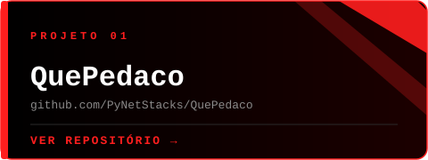
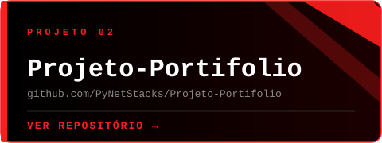
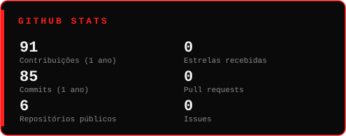
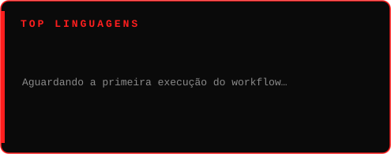
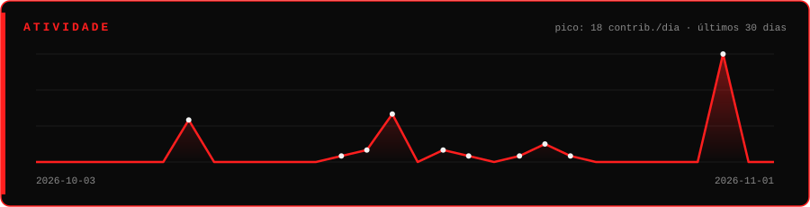
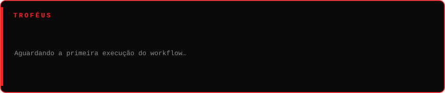
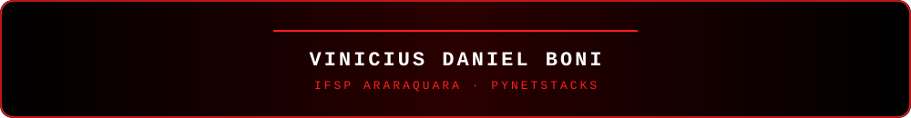

 

## ▍SOBRE MIM

Sou o **Vinicius**, estudante do **técnico integrado em Informática** no **IFSP, campus Araraquara**.

Escrevo código principalmente em **Python**, **JavaScript** e **TypeScript**. **Git**, **GitHub** e **Claude Code** fazem parte da minha stack, e meus projetos ficam publicados aqui, em **PyNetStacks**.

 

## ▍STACK

 

## ▍PROJETOS

 

## ▍GITHUB STATS

 

 

## ▍ATIVIDADE

 

## ▍TROFÉUS

 

## ▍SNAKE

 

## ▍CONTATO

  

